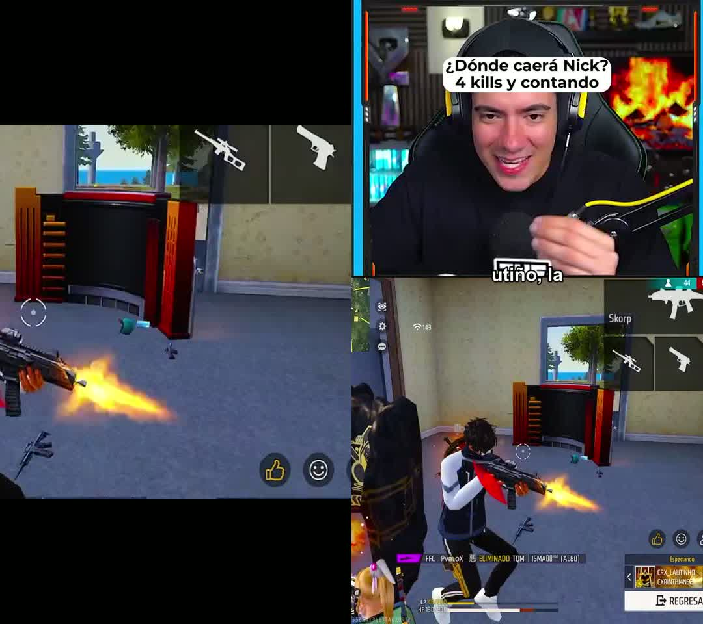

# Formato «Cámara + juego» (streams de juegos y reacciones)

La cámara del streamer va arriba y el juego (o lo que está viendo) abajo, en un clip vertical de 1080 × 1920 (o 1440 × 2560).

Probado con *ENFRENTE A ESTE YOUTUBER VS 48 SUSCRIPTORES EN FREE FIRE* (TheDonato, 29 min, 1080p60).

## Cómo funciona (todo local, sin servicios de pago)

1. **Detección de la cámara (una vez por video, ~10 s).** Se toman 40 fotogramas repartidos por todo el video. Se busca una cara que aparece siempre en el mismo lugar con YuNet, el mismo detector del seguimiento facial. El rectángulo de la cámara se calcula con los bordes que no se mueven en ningún fotograma: el marco de la cámara o la unión entre la cámara y el juego. El juego se mueve debajo; el marco no.
2. **Zona del juego.** Si la pantalla tiene una barra lateral (la de TheDonato tiene la cámara y un dibujo a la derecha), se detecta su línea vertical fija y solo se usa la zona del juego. Si la cámara está pintada encima del juego, se usa toda la pantalla y el recorte evita mostrar la cámara dos veces.
3. **Panel de arriba.** Ocupa entre el 40 y el 50 % de la altura según la forma de la cámara, centrado en la cara. Se amplía con Lanczos y un enfoque suave (la cámara de un stream suele ser pequeña).
4. **Panel de abajo.** Recorte del juego a toda su altura. Sigue la acción (movimiento) de forma suave: se inclina hacia el centro de la pantalla, donde los juegos ponen la acción; tiene zona muerta, suavizado sin retraso y límite de velocidad. No salta en los cortes de escena: en los juegos, los flashes y las explosiones parecen cortes (4 de 10 en un clip de 40 s).
5. **Vista previa = exportación.** El editor dibuja los mismos dos recortes en un lienzo con los mismos números que FFmpeg. Diferencia media medida entre la vista previa y el MP4: 5–6 de 255 por píxel, que corresponde a la compresión y a la sincronización de fotogramas, no a un desplazamiento.

## Dónde se elige

- **«Configura tus clips»** tiene una tercera tarjeta, «Cámara + juego», con una vista previa real del video, y el interruptor *«Usar Cámara + juego automáticamente cuando el video tenga la cámara del streamer»*, activado por defecto. Si el video no tiene cámara superpuesta, se usa el encuadre elegido (zoom o pantalla completa).
- **Editor › Encuadre:** «Formato vertical › Cámara + juego · streams», *Seguir la acción del juego*, *Movimiento* (suave, equilibrado o rápido) y **«Ajustar recuadro de cámara»**: se arrastra el recuadro amarillo sobre la cámara y se cambia su tamaño desde la esquina. Vale para todos los clips del video.
- Los clips del **clipping en vivo** usan la misma configuración al abrirse en el editor.

## Calidad

| Exportación con GPU (NVENC), clip de 20 s a 1080p60 | Tamaño | SSIM frente a cq 14 |
|---|---|---|
| cq 26 (antes) | 39 MB | 0,9892 |
| **cq 23 (ahora)** + AQ temporal | 55 MB | 0,9920 |
| cq 21 | 69 MB | 0,9933 |

Se eligió cq 23: más limpio que antes sin duplicar el tamaño. Además:

- Escalado Lanczos y enfoque en la cámara.
- Opción **1440 × 2560**: se escala al final y YouTube Shorts procesa las subidas de más de 1080p con más bitrate. No inventa detalle que la fuente no tiene.

Velocidad medida: un clip de 20 s se exporta en unos 5 s (con títulos y subtítulos). Si otro programa usa la GPU al mismo tiempo (CapCut, juegos), tarda más.

## Límites conocidos

- **Una sola posición de cámara por clip.** Si en el mismo clip el streamer mueve la cámara (por ejemplo, para mostrar una página web y luego vuelve al juego), el editor avisa: *«En este clip casi no se ve al streamer en el recuadro…»*. Probé a buscar la cámara de nuevo dentro del clip: en un video editado con zooms eligió un recorte equivocado (el pecho en vez de la cara), así que no se hace automáticamente. Usa «Ajustar recuadro de cámara» u otro encuadre.
- **Intros sin cámara:** mismo aviso.
- **Reacciones:** si la ventana del video aparece con bordes fijos que ocupan más de la mitad de la pantalla, se detecta como zona de contenido. Todavía no está probado con un stream de reacción real.
- Se conserva el marco decorativo de la cámara del streamer, como en el video de referencia.
